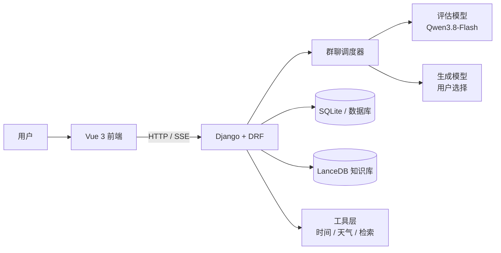

# AstraMates

> 多智能体社交与动态发言调度系统  
> Multi-agent social platform with dynamic speaker scheduling

AstraMates 是一个面向 AI 角色社交的多智能体平台：用户可以创建 AI 角色，与角色单聊，也可以把多个角色放进同一个群聊，由调度系统决定每一轮谁先说、谁补充、什么时候结束。

本项目不是简单的“让所有角色轮流说话”。每个角色会先判断自己是否适合发言、是否值得补充，再由调度器完成发言选择。

> 本仓库是项目展示仓库，只包含说明文档、架构图和实测数据，不包含源码。源码保存在私有仓库。

**在线体验：** <https://app8092.acapp.acwing.com.cn/>

---

## 项目亮点

- **AI 角色系统**：角色创建、编辑、头像、背景、声音、人物设定
- **单聊**：一对一流式对话，支持图片、文档、语音输入
- **多智能体群聊**：多角色讨论，动态决定发言人数
- **显式/软点名**：支持 `@`、自然语言呼叫和硬性单人指令
- **双模型架构**：评估与生成分离，评估模型固定，生成模型可选
- **动态调度**：不是全员轮流，也不是固定人数
- **稳定性设计**：超时缓存、评估兜底、失败角色跳过、429 冷却
- **完整部署**：Django + Gunicorn + Nginx + SSE

---

## 系统架构



### 一次群聊的流程

```text
用户发送消息
  ↓
解析 @、点名、硬性单人指令
  ↓
本地粗筛候选角色
  ↓
评估模型批量打分
  ↓
调度器计算综合分并确定发言顺序
  ↓
按顺序流式生成回复
  ↓
补充评估 / 高价值重复判断
  ↓
结束本轮
```

---

## 调度系统

当前为第 10 代调度系统。

### 评估与生成解耦

```text
评估模型：负责选人
生成模型：负责说话
```

评估模型只输出结构化评分：

```text
relevance     相关度
novelty       新颖度
willingness   发言意愿
can_answer    是否能回答
would_repeat  是否会重复
```

评估模型固定为 `Qwen3.8-Flash`，用户选择只影响生成模型。

### 综合分

```text
首位发言：
FIRST = relevance × 0.5 + novelty × 0.3 + willingness × 0.2

后续补充：
FOLLOW = novelty × 0.5 + relevance × 0.3 + willingness × 0.2
```

再叠加：

- 等待加成
- 最近发言频率惩罚
- 发言门槛
- 去重和高价值重复规则

### 点名优先级

```text
硬点名 > @ > 软点名 > 普通调度
```

- **硬点名**：只允许被点名者发言
- **软点名**：被点名者优先，其他人达到门槛仍可补充
- **普通提及**：提高意愿分，不强制第一
- **无点名**：正常进入候选评估

### 动态人数

`max_turns` 是安全上限，不是必须达到的目标：

```text
普通消息：最多 5 人
复杂讨论：最多 7 人
开放讨论：最多 10 人
```

实际可能只有 1 人回复，也可能 2–3 人。没有合格补充者时提前结束，不为了凑人数硬塞低质量角色。

更多细节见：

- [调度系统说明](docs/scheduler.md)
- [系统架构](docs/architecture.md)

---

## 实测数据

以下为内部离线测试与压力测试结果，不代表所有线上场景。

### 第一发言人

```text
样本：46
成功：46/46
与基线一致率：73.9%
平均评估延迟：3.13 秒
p95：5.23 秒
```

### 明确补充发言人

```text
样本：24
成功：24/24
是否补充二分类：24/24
明确应补充时选人：18/18
明确不应补充时选 NONE：6/6
平均延迟：2.36 秒
```

### 并发

```text
9 / 15 / 20 个群聊压力测试
全部成功
限流：0
```

当前模型闸门为 4，20 个群是“4 路并发 + 队列消化”的结果，不等于 20 个模型请求同时执行。

更多数据见：

- [测试与数据](docs/metrics.md)

---

## 技术栈

| 层 | 技术 |
|---|---|
| 后端 | Django 6、Django REST Framework、SimpleJWT |
| 前端 | Vue 3、Vite、Pinia、Vue Router |
| 模型编排 | LangChain、LangGraph、OpenAI 兼容接口 |
| 流式通信 | SSE |
| 数据库 | SQLite（当前单机部署） |
| 向量检索 | LanceDB |
| 部署 | Gunicorn、Nginx |
| 文档解析 | python-docx、pypdf、openpyxl |

---

## 项目结构说明

本仓库只展示结构，不包含源码：

```text
AstraMates-Showcase/
├── README.md
├── docs/
│   ├── architecture.md
│   ├── scheduler.md
│   ├── backend.md
│   ├── frontend.md
│   ├── deployment.md
│   └── metrics.md
├── modules/
│   ├── backend/
│   │   └── README.md
│   ├── frontend/
│   │   └── README.md
│   ├── scheduler/
│   │   └── README.md
│   └── ai-agents/
│       └── README.md
└── screenshots/
    └── README.md
```

---

## 设计取舍

### 评估与生成分离

- 评估要快、稳定、便宜
- 生成要质量、角色感、工具能力
- 两者不绑定同一个模型

### 不强制每轮多人

- 没有合格补充者就提前结束
- 不为了凑人数硬塞低质量角色
- 保留自然聊天的稀疏感

### 单机优先

- 当前使用 SQLite + 单 worker + 多线程
- 群聊本轮模型切换状态保存在进程内
- 多 worker 部署需要把状态迁移到 Redis/数据库

---

## 已知限制

- 单聊模型选择保存在浏览器本地，换设备不会同步
- 群聊本轮模型切换状态保存在进程内，多 worker 需要共享存储
- SQLite 不适合高并发多写；规模上来后需要 MySQL/PostgreSQL
- 角色能力匹配依赖角色简介质量
- 手机端模型名称过长时会省略显示

---

## 文档

- [系统架构](docs/architecture.md)
- [调度系统](docs/scheduler.md)
- [后端设计](docs/backend.md)
- [前端设计](docs/frontend.md)
- [部署说明](docs/deployment.md)
- [测试与数据](docs/metrics.md)
- [后端模块](modules/backend/README.md)
- [前端模块](modules/frontend/README.md)
- [调度模块](modules/scheduler/README.md)
- [AI 角色模块](modules/ai-agents/README.md)
- [截图目录](screenshots/README.md)

---

## 开发者

田书睿（tsr）

本项目为个人项目，暂未指定开源许可证。
